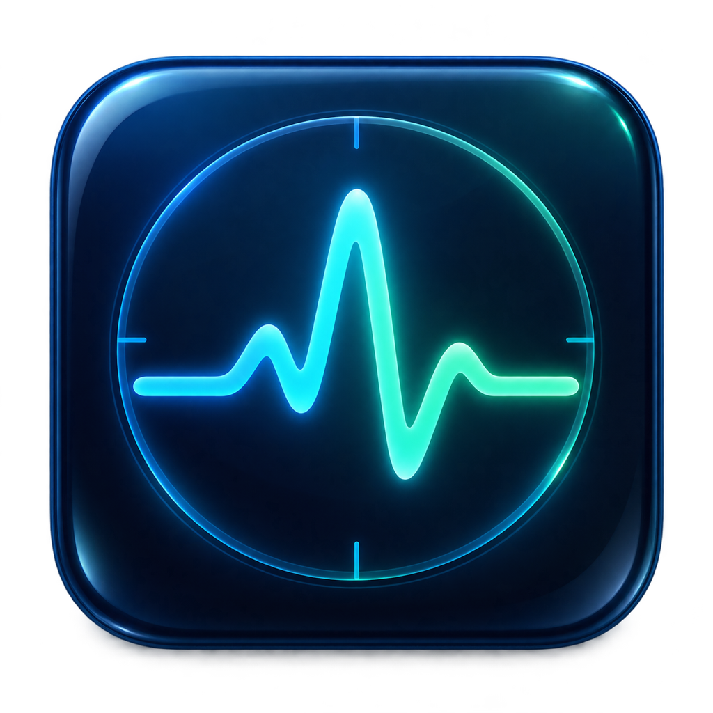
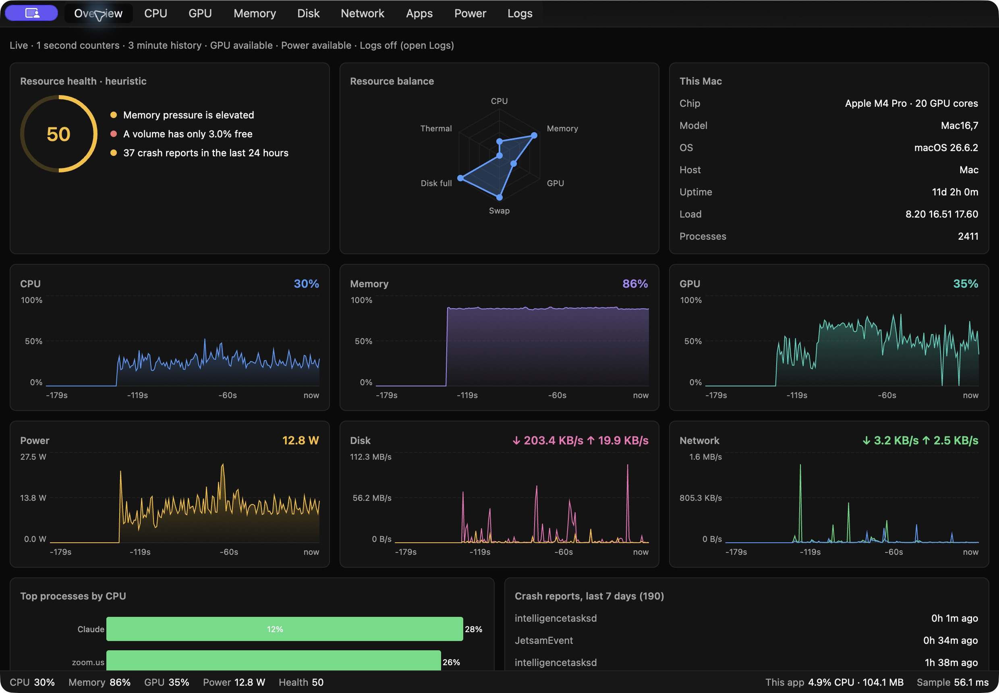

<p align="center">
  
</p>

# SystemMonitor

[](https://github.com/giridharmb/SystemMonitor/actions/workflows/ci.yml)
[](LICENSE)
[](#run)

A native macOS system monitor written in Rust with **GPUI Kit 0.8.1**. Nine tabs combine live kernel counters, GPU accelerated charts, a virtualized applications table, and a bounded unified-log viewer. There is no web view, server, telemetry upload, or privileged helper.



[Metric sources](docs/ARCHITECTURE.md) · [Xcode guide](docs/XCODE.md) · [Signed DMGs](docs/DISTRIBUTION.md) · [Validation](docs/VALIDATION.md) · [Contributing](CONTRIBUTING.md)

## Run

Requires macOS, Rust 1.99 or newer, and Xcode Command Line Tools (`xcode-select --install`). Apple Silicon is the primary supported hardware. Intel Macs may lack the optional GPU, power, and frequency sources.

```sh
git clone https://github.com/giridharmb/SystemMonitor.git
cd SystemMonitor
cargo run --release --locked
```

For a double-clickable application:

```sh
./scripts/bundle.sh
open target/release/SystemMonitor.app
```

The bundle is signed locally with an ad hoc signature. For a Developer ID signed, notarized DMG that others can install, use [the distribution scripts and setup guide](docs/DISTRIBUTION.md). No files are installed outside the project.

Build products and DMGs are generated locally and are not included in the Git checkout. The currently validated distribution image is **signed-only**, pending notarization; it is not a Gatekeeper-ready public download.

An [Xcode project](SystemMonitor.xcodeproj) is included: open it and choose **SystemMonitor > My Mac**. Select your own signing team, or use local ad hoc signing, then press **Cmd+R**. See [Xcode setup, debugging and archive instructions](docs/XCODE.md). XcodeGen is only needed if you want to regenerate the project.

The app includes a custom macOS icon in both build paths. See [artwork and icon rebuild instructions](assets/README.md).

## Explore

| Tab | Contents |
| --- | --- |
| Overview | Explainable resource-health score, resource radar, CPU/memory/GPU/power/disk/network trends, top processes, recent crash reports |
| CPU | Total/user/kernel usage, per-logical-core bars and sparklines, actual efficiency/performance core labels, load averages, cluster frequency and activity |
| GPU | Whole-device, renderer and tiler utilization; allocated/used memory; GPU frequency and power; Neural Engine power |
| Memory | App/wired/compressed/cached/free composition, pressure, swap, paging and compressor rates, process footprints |
| Disk | Volume capacity, aggregate physical-device throughput, IOPS, average operation time, cumulative errors, top process I/O |
| Network | Per-interface rates/totals/errors, aggregate traffic, listening TCP ports with process names and PIDs |
| Apps | Grouped app bundles including helpers, or all processes; sortable/filterable CPU, memory, threads, disk I/O, wakeups and billed energy |
| Power | CPU/GPU/Neural Engine/DRAM power, thermal pressure, available temperature sensors, battery condition and power flow |
| Logs | Live key OS logs; errors/faults, kernel, security and power filters; text search; pause/follow/clear; message details |

Features extending Activity Monitor's usual presentation include the integrated log watcher and crash summary, resource-health explanations, disk operation timings/IOPS, listening-port ownership, app-bundle aggregation, and component power/frequency charts. Availability varies by hardware and account permissions.

**Cmd+1…9** switches tabs in the order above. **Cmd+Q** and **Cmd+W** quit and stop the log child process. Charts support hover inspection. The Apps table supports column sorting and resizes. Logs retain at most 5,000 entries in the reader queue and 5,000 displayed entries; old entries are evicted automatically. Log capture starts when Logs is selected and stops when leaving that tab; existing displayed entries remain. Events during the gap are not captured. Pause freezes the displayed list while the bounded reader continues collecting.

```sh
cargo run --release --locked -- --tab cpu
cargo run --release --locked -- --tab logs
# Local NDJSON samples without a GUI. Redirect if you want a snapshot file.
target/release/SystemMonitor --diagnostics 10 > samples.ndjson
# Inspect optional channel names and frequency tables on this Mac.
target/release/SystemMonitor --dump-ioreport
```

Diagnostics accepts 1–3,600 seconds and prints one schema-versioned record per sample. It does not start the log watcher or represent the GUI's overhead. The first collector pass establishes baselines before rates are emitted. Process refresh counts are `null` between process refreshes; unavailable optional power/GPU readings are `null`.

## Efficiency

Counters run on a dedicated sampler thread, normally once per second. Process enumeration runs every two seconds on relevant foreground tabs and every ten seconds otherwise. Temperatures, battery, ports and volume/crash discovery have slower schedules. The port probe has a two-second timeout and a 256 KiB output limit. Only the selected tab is constructed. Charts have their appearance animations disabled, and keep 180 samples rather than growing indefinitely. No log subprocess runs until the Logs tab is selected. Background windows request ordinary metric repaints every five seconds; the log view drains at 4 Hz only while active. UI events can still repaint immediately.

The status bar reports this application's own CPU/RSS and sampler duration. **Use a release build for performance measurements.** Debug Rust builds, open chart tooltips, log storms, other applications, screen resolution, and protected process queries can change the cost substantially. See [validation](docs/VALIDATION.md) for measured results and the reproduction procedure; this is an efficiency-oriented implementation, not a guarantee of a universal CPU or memory ceiling.

## Accuracy and permissions

- System/core CPU percentages use 100% for full utilization. A process uses 100% for **one** logical core and may exceed 100%.
- macOS does not expose a supported per-GPU-core utilization breakdown here. The GPU page explicitly shows device/pipeline-stage utilization and the reported core count; individual GPU-core values are never fabricated.
- App memory is physical footprint where permitted, otherwise RSS. Grouped totals sum processes and can count shared pages more than once. Protected per-process counters can be zero. A billed-energy rate is an estimate from kernel accounting, not whole-machine electrical power.
- Power/frequency and several IOKit counters rely on undocumented Apple interfaces. Missing device-level GPU/power sources are labeled unavailable. Individual absent channel values may be zero. Cluster clock tables are chip-dependent; verify them before trusting a new chip family. Per-core CPU utilization comes directly from Mach ticks, independent of those tables.
- A full allocated swapfile is not by itself a health problem: macOS allocates swap dynamically. Health considers active swap-out under memory pressure. Log-rate health deductions apply only while capture is running. The health score is an explainable heuristic, not a hardware test, SMART diagnostic, malware scan, or prediction of failures.
- Logs use macOS's filtered unified log stream, respecting account access and `<private>` redaction. Logs may be sparse, access-denied, or noisy; the watcher does not read every traditional log file. No root access or Full Disk Access is requested automatically. Stream failures appear on the Logs tab; switch away and back to Logs to reconnect.
- Network aggregation excludes loopback but can count tunneled/VPN/bridge traffic at more than one interface layer. Disk counters aggregate storage drivers, not individual volumes. APFS volumes may share capacity. Volume free space uses `statfs`, excluding Foundation’s reclaimable-space estimates. The writable Data volume is included in capacity health checks. Driver timings are operation accounting, not measured end-to-end application latency.
- Crash discovery scans accessible `.ips`, `.crash` and `.panic` reports from the last seven days, including diagnostic reports that need not represent app crashes. Missing temperature sensors are reported as unavailable.

See [architecture and metric sources](docs/ARCHITECTURE.md) for sampling schedules, formulas, thresholds, ownership, and design choices.

## Validate

```sh
./scripts/validate.sh
./scripts/bundle.sh
```

Checks include formatting, strict linting, unit and live hardware tests, offline DMG release-workflow tests, a release build, and headless collector sampling. Python 3 is required for the validation and packaging scripts. GitHub Actions runs the same checks on a macOS runner. Interactive/visual acceptance and supported hardware limitations are recorded separately in [docs/VALIDATION.md](docs/VALIDATION.md).

## GPUI Kit examples studied

The application follows the upstream [hello-world lifecycle](https://github.com/longbridge/gpui-kit/blob/944803984cf0ba3111861d6e1aa9d6265c109ff9/examples/hello_world/src/main.rs), [chart showcase](https://github.com/longbridge/gpui-kit/blob/944803984cf0ba3111861d6e1aa9d6265c109ff9/crates/story/src/stories/chart_story/chart_story.rs), and [DataTable showcase](https://github.com/longbridge/gpui-kit/blob/944803984cf0ba3111861d6e1aa9d6265c109ff9/crates/story/src/stories/data_table_story.rs). It uses Kit's `application`, assets, `init`, root-window wrapper, themed controls, `AreaChart`, `BarChart`, `PieChart`, `RadarChart`, and virtualized `DataTable`. Dependency versions are fixed by Cargo.lock; Kit itself is pinned exactly in Cargo.toml.

## Contributing and support

Use the [bug report](https://github.com/giridharmb/SystemMonitor/issues/new?template=bug_report.yml) or [feature request](https://github.com/giridharmb/SystemMonitor/issues/new?template=feature_request.yml) forms. Include the Mac chip, macOS version, affected tab and a small reproduction. Review [CONTRIBUTING.md](CONTRIBUTING.md) before submitting a pull request and [SECURITY.md](SECURITY.md) before reporting a vulnerability. Redact private log messages, process paths and network details from attachments.

## License

[MIT](LICENSE), copyright 2026 Giridhar Bhujanga. Dependencies retain their own licenses; see [third-party acknowledgments](docs/ACKNOWLEDGMENTS.md). The app icon was generated with the built-in image-generation tool; its source and prompt are documented in [assets/README.md](assets/README.md).
